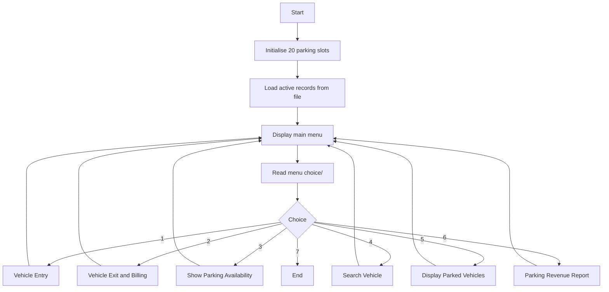

# Smart Campus Parking System

A menu-driven, console-based parking management application developed in **C** for the C Programming Lab Mini Hackathon.

## 1\. Problem Statement

Managing vehicle parking manually on a campus can make it difficult to track available spaces, identify parked vehicles, prevent duplicate entries, calculate parking charges, and maintain transaction records. Manual records can also become inconsistent when vehicles enter or leave.

The **Smart Campus Parking System** provides a simple console-based solution for managing a parking area with a fixed capacity of 20 slots. It records vehicle entry and exit, assigns parking slots automatically, calculates fees using the parking duration, and stores active parking details and completed transactions in text files.

## 2\. Team Details


|Detail|Information|
|-|-|
|Team Number|**05**|
|Batch|**51**|
|Team Member 1|**Pratyaksh Gupta**  (590037999)|
|Team Member 2|**Aryan Panwar**     (590035570)|
|Team Member 3|**Pranamya Agarwal** (590040682)|

## 3\. Objectives

* Develop a menu-driven parking management program using the C language.
* Maintain the status of 20 parking slots.
* Automatically assign the lowest-numbered available slot to an entering vehicle.
* Validate vehicle registration numbers and prevent duplicate active entries.
* Record entry and exit times and calculate parking charges.
* Preserve active parking records when the program is closed and restarted.
* Maintain a history of completed parking transactions.
* Provide vehicle search, parking availability, parked-vehicle listing, and revenue-reporting options.

## 4\. Features

1. **Vehicle Entry**

   * Accepts a vehicle registration number and category.
   * Converts registration numbers to uppercase.
   * Accepts 1 to 19 letters, digits, or hyphens, with at least one letter or digit.
   * Rejects invalid and duplicate active registrations.
   * Assigns the first available slot.
   * Saves the active parking record.
2. **Vehicle Exit**

   * Finds the parked vehicle using its registration number.
   * Calculates elapsed parking time using the system clock.
   * Generates a bill using the vehicle category and billable hours.
   * Records the completed transaction.
   * Keeps or restores the active vehicle record if saving the exit transaction fails.
3. **View Parking Availability**

   * Displays all 20 slots as occupied or available.
   * Shows occupied, available, and total slot counts.
4. **Search Vehicle**

   * Searches for a currently parked vehicle by registration number.
   * Displays its category, slot, and entry time when found.
5. **Display Parked Vehicles**

   * Lists all currently parked vehicles with their category, slot number, and entry time.
6. **Parking Revenue Report**

   * Reads completed transactions.
   * Displays the number of completed transactions and revenue by vehicle category.
   * Displays total revenue.
7. **Text-file Storage**

   * `parking_records.txt` stores currently parked vehicles.
   * `transactions.txt` stores completed parking transactions.
   * Active parking records are loaded when the program starts.

## 5\. Parking Categories and Charges

The following rates are defined in the source code for this project:

|Vehicle Category|Rate|
|-|-:|
|Two-wheeler|Rs. 10 per hour|
|Four-wheeler|Rs. 20 per hour|
|Other|Rs. 30 per hour|

**Billing rule:** Every started hour is charged as a full hour. The minimum billable duration is one hour.

For example, a four-wheeler parked for 2 hours and 10 minutes is charged for 3 hours:

`3 × Rs. 20 = Rs. 60`

These are project demonstration rates, not official campus parking rates.

## 6\. Algorithm / Pseudocode

### Main Program

```text
START
    Initialise all 20 parking slots
    Load active vehicle records from parking\_records.txt

    REPEAT
        Display the main menu
        Read a menu choice from 1 to 7

        IF choice is 1
            Perform Vehicle Entry
        ELSE IF choice is 2
            Perform Vehicle Exit
        ELSE IF choice is 3
            Display Parking Availability
        ELSE IF choice is 4
            Search for a Vehicle
        ELSE IF choice is 5
            Display Parked Vehicles
        ELSE IF choice is 6
            Display Parking Revenue Report
        ELSE IF choice is 7
            Display exit message
            END PROGRAM
        END IF
    UNTIL the program ends
END
```

### Vehicle Entry

```text
Read vehicle registration number
Convert registration number to uppercase

IF registration number is invalid
    Display an error and return to the menu
END IF

IF vehicle is already parked
    Display duplicate-entry message and return
END IF

Find the lowest-numbered free slot

IF no free slot exists
    Display parking-full message and return
END IF

Read vehicle category
Get the current system time
Add vehicle details to the parking array
Save active records to parking\_records.txt

IF saving fails
    Undo the in-memory entry
    Display an error
ELSE
    Display assigned slot and entry details
END IF
```

### Vehicle Exit and Billing

```text
Read vehicle registration number
Convert it to uppercase and validate it
Search for the vehicle

IF vehicle is not parked
    Display not-found message and return
END IF

Get current system time
Calculate elapsed seconds using difftime()
Calculate billable hours by rounding started hours upward
Use a minimum of one billable hour
Calculate fee = billable hours × category rate

Prepare the transaction record
Remove the vehicle from the active parking list
Save the updated active parking records

IF saving active records fails
    Restore the vehicle in memory
    Cancel the exit
ELSE
    Append the completed transaction to transactions.txt

    IF transaction saving fails
        Restore the vehicle in memory
        Try to save the restored active records
        Do not complete the exit
    ELSE
        Confirm exit and release the slot
    END IF
END IF
```

## 7\. Program Flowchart

The following high-level flowchart represents the console-based program:



## 8\. C Programming Concepts Used

|C Concept|How it is used|
|-|-|
|Variables and Data Types|Store menu choices, slot numbers, vehicle categories, timestamps, durations, and fees.|
|Constants and `#define`|Define parking capacity, registration-number size, file names, vehicle categories, and hourly rates.|
|Structures|`struct Vehicle` stores active vehicle details. `struct Transaction` stores completed transaction details.|
|Arrays|The `parking` array stores the 20 parking slots. Character arrays store registration numbers and input lines.|
|Strings|Registration numbers are copied, compared, validated, and converted to uppercase.|
|Functions|Separate functions handle entry, exit, searching, validation, file operations, billing, and reports.|
|Conditional Statements|Validate input, check slot availability, identify vehicle categories, and handle menu choices.|
|Loops|Iterate through parking slots, process records, and repeatedly display the menu.|
|`switch` Statement|Selects the operation corresponding to the user's menu choice.|
|Pointers|File pointers (`FILE \*`) and string parsing pointers are used.|
|File Handling|`fopen()`, `fgets()`, `fprintf()`, `fclose()`, and `sscanf()` read and write text files.|
|Time Handling|`time()`, `difftime()`, `localtime()`, and `strftime()` manage and display parking times.|
|Character Handling|`toupper()`, `isalnum()`, and `isspace()` help normalise and validate input.|
|Standard Library Functions|Functions such as `strlen()`, `strcmp()`, `strcpy()`, `memset()`, and `strtol()` are used.|

## 9\. Files Created by the Program

### `parking_records.txt`

Stores currently parked vehicles. Each line uses this format:

```text
registration_number|vehicle_type|slot_number|entry_timestamp
```

Example format:

```text
DL8CAB1234|2|1|1795102194
```

The values represent the registration number, category code, slot number, and entry timestamp. Category codes are `1` for two-wheeler, `2` for four-wheeler, and `3` for other.

### `transactions.txt`

Stores completed parking transactions. Each line uses this format:

```text
registration\_number|vehicle\_type|slot\_number|entry\_timestamp|exit\_timestamp|duration\_hours|amount\_paid
```

The program appends completed transactions to this file. The revenue report reads this file to calculate category-wise and total revenue.

Both files are created in the program's current working directory when needed.

## 10\. Compilation and Execution

### Requirements

* GCC compiler
* Visual Studio Code or another code editor
* Windows, Linux, or another environment with a compatible GCC toolchain

### Windows (PowerShell)

Open the project folder in VS Code or PowerShell and run:

```powershell
gcc -g smart_campus_parking.c -o parking.exe
.\parking.exe
```

### Linux

```bash
gcc -g smart_campus_parking.c -o parking
./parking
```

The program uses standard C library headers and does not require an additional third-party library.

**Important:** Run the executable from the folder where you want `parking_records.txt` and `transactions.txt` to be stored. Do not delete these files if you want to retain the saved parking data and transaction history.

## 11\. Sample Test Cases

The following tests were run against the supplied `smart_campus_parking.c` source using GCC 14.2.0. The program compiled successfully without any compiler warnings.

|Test|Input / Setup|Expected Output|Actual Result|
|-|-|-|-|
|1. Valid vehicle entry|Register `DL8CAB1234`, category `2`|Vehicle is accepted, assigned slot 1, and 19 slots remain available.|**Passed.** `Entry successful. Slot number: 1` and `Available slots: 19` were displayed.|
|2. Duplicate registration|Enter `DL8CAB1234` again while it is parked|Duplicate entry is rejected.|**Passed.** `This vehicle is already parked. Duplicate rejected.`|
|3. Search parked vehicle|Search for `DL8CAB1234` after entry|Program displays the vehicle, category, and assigned slot.|**Passed.** The vehicle was found and its category and slot 1 were displayed.|
|4. Persistence after restart|Start the program again after saving the vehicle|Program loads the active vehicle from `parking_records.txt`.|**Passed.** `Loaded 1 active vehicle(s).` was displayed and the vehicle appeared in the parked-vehicle list.|
|5. Parking full|Start with all 20 slots occupied, then attempt another entry|Program rejects the new entry and displays a full-capacity message.|**Passed.** `Parking area is FULL.`|
|6. Exit and billing|Four-wheeler with a test entry timestamp 7,800 seconds before exit|2.17 hours elapsed, 3 billable hours, fee Rs. 60.00, and slot released after successful saving.|**Passed.** `Duration: 2.17 hour(s)`, `Billable hrs: 3`, `Amount: Rs. 60.00`, and `Exit completed. Slot 1 is now available.`|
|7. Revenue report|Run the report after Test 6|Four-wheeler revenue and total revenue should both be Rs. 60.00.|**Passed.** `Four-wheeler revenue: Rs. 60.00` and `TOTAL REVENUE: Rs. 60.00`.|

### Notes on Test Results

* The billing test used a prepared test record with an entry time 7,800 seconds before the exit test. This made the billing scenario repeatable.
* The entry, duplicate, search, restart-persistence, full-capacity, exit, and revenue-report scenarios above were executed.
* File-write failure recovery, malformed-file handling, invalid registration input, and every possible boundary condition have **not** been exhaustively tested. Do not treat them as passed tests until they have been run separately.
* Timestamps and displayed entry/exit clock times vary according to the system clock. The expected billing amount in Test 6 remains Rs. 60.00 for the stated test setup.

## 12\. Limitations and Possible Future Improvements

* The current application is a console-based prototype and does not provide a graphical interface.
* The parking capacity is fixed at 20 slots in the source code.
* Parking rates are defined as constants and require a source-code change to modify.
* The program uses local text files and does not provide a database or multi-user network access.
* Possible future improvements include configurable capacity and rates, stronger file recovery, and a database-backed version if the project scope is expanded.

## 13\. Conclusion

The Smart Campus Parking System demonstrates how fundamental C programming concepts can be combined to solve a practical parking-management problem. It supports vehicle entry and exit, automatic slot allocation, parking-time billing, file-based record storage, vehicle search, availability checking, and revenue reporting through a simple menu-driven interface.

\---

**Project:** Smart Campus Parking System  
**Language:** C  
**Interface:** Console-based  
**Parking Capacity:** 20 slots  
**Compiler used for verification:** GCC 14.2.0

